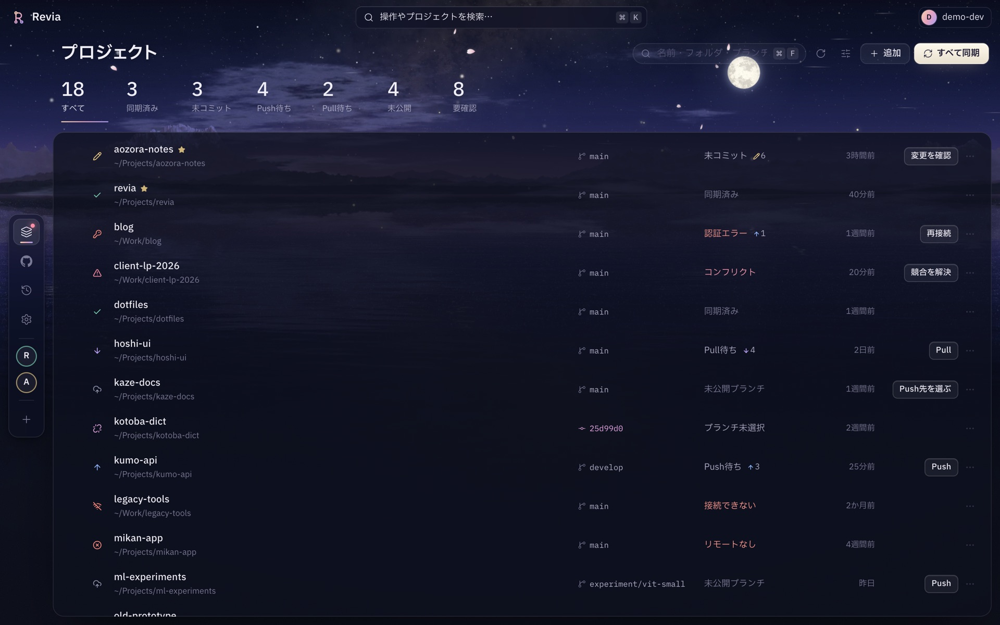

# Revia

Scattered projects, one calm workspace.

あちこちに散らばったローカルプロジェクトと GitHub リポジトリを、ひとつの画面でまとめて確認・同期できるデスクトップアプリです。フォルダを登録しておくと、未コミットの変更があるものや、Push・Pull が必要なものがひと目で分かり、そのまま操作できます。

[ダウンロード](https://github.com/Shake1227/Revia/releases) · [構成](docs/ARCHITECTURE.md) · [IPC 仕様](docs/API_CONTRACT.md) · [デザイン](docs/BRAND.md)



## できること

- 登録したフォルダから Git リポジトリや開発プロジェクトを自動で見つけ、状態（未コミット、Push 待ち、Pull 待ち、コンフリクトなど）を一覧表示
- 「同期」で、変更のコミットから Pull・Push までをまとめて実行。.env など秘密情報らしい新しいファイルはコミットしない
- ローカルとリモートの両方に変更があるときの扱いを設定で選べる（止めて知らせる、両方を取り込む、重なった部分は手元またはリモートを優先）
- 複数のプロジェクトを選んで、Fetch / Pull / Push / コミット / Merge / GitHub への公開をまとめて実行
- 差分の確認とコミット、ブランチの作成・切り替え・Merge・Rebase、コンフリクトの解消
- まだ Git を使っていないフォルダも、Git への登録からリポジトリの作成、Push まで続けて公開（Git への登録だけで止めることも可能）
- GitHub のリポジトリ一覧からの Clone
- 連携の解除（リモートの設定を外す / Git の管理をやめる）と削除（このコンピューターからだけ / GitHub のリポジトリも）
- 強制 Push や Hard Reset、削除などの危険な操作は、影響を表示してから確認。強制 Push と Hard Reset は初期状態で無効
- 時刻に合わせて移り変わる湖の背景、星霧、無地、好きな画像。ダーク / ライト / 空の明るさに合わせるテーマ
- 新しいバージョンの確認と、インストーラーの取得
- 日本語、英語

削除するフォルダと `.git` は、完全には消さずに OS のゴミ箱へ移します。GitHub のリポジトリの削除だけは取り消せないため、`owner/name` を入力して確認します。

GitHub へのログインは GitHub CLI（`gh`）に任せています。認証情報を Revia が保存することはありません。

## インストール

[リリースページ](https://github.com/Shake1227/Revia/releases)から、お使いの OS 用のファイルをダウンロードしてください。

| OS | ダウンロードするファイル | 対応環境 |
| --- | --- | --- |
| macOS | `.dmg`（Apple シリコン / Intel 共通） | macOS 11 以降 |
| Windows | `-setup.exe` または `.msi` | Windows 10 / 11（x64） |
| Linux | `.deb`、`.rpm`、`.AppImage` | x86_64 |

Git が必要です。GitHub との連携には GitHub CLI（`gh`）を使います。入っていない場合は、Revia の画面からそのままインストールできます。

動作を確認しているのは macOS 版です。Windows 版と Linux 版は、実機での確認がまだできていません。

### Mac で初めて開くとき

DMG を開き、Revia を Applications フォルダへドラッグしてください。Mac 版は Apple の公証を受けていないため、初回に「悪質なソフトウェアかどうかを Apple で確認できない」と表示されます。この GitHub の配布版を開く場合は、次の手順で許可できます。

1. Applications の Revia を開き、警告を閉じます。
2. **システム設定 → プライバシーとセキュリティ**を開き、下にスクロールします。
3. Revia の **「このまま開く」** を押し、次の確認で **「開く」** を選びます。

macOS 14 以前では、Finder で Revia を右クリックして「開く」を選ぶ方法も使えます。詳しくは [Apple の案内](https://support.apple.com/ja-jp/102445#openanyway)を参照してください。

### Windows と Linux

Windows は `-setup.exe`（日本語 / 英語を選べます。管理者権限は不要）か `.msi` を実行してください。SmartScreen の警告が出たら「詳細情報」→「実行」で進めます。

Linux は、Debian / Ubuntu なら `.deb`、Fedora などは `.rpm` を使ってください。`.AppImage` は実行権限を付けて起動します。

## 使い方

1. 初回の起動で、プロジェクトを置いているフォルダを登録します。中にある Git リポジトリと開発プロジェクトが一覧に並びます。
2. 一覧では、プロジェクトごとの状態と、次にできる操作（Pull、Push、変更の確認など）が行の右に出ます。「すべて同期」で、まとめて同期できます。
3. プロジェクトを開くと、変更・ブランチ・履歴・設定を確認できます。コミットやブランチの操作はここで行います。
4. 左のドックから GitHub の画面を開くと、ログイン、リポジトリの一覧、Clone ができます。
5. `⌘K`（Windows / Linux は `Ctrl+K`）で、操作とプロジェクトをまとめて検索できます。

行った操作は履歴に残ります。背景やテーマ、言語、同時に実行する数、同期のしかたは設定で変えられます。一覧から除外したフォルダは、設定の「除外したフォルダ」から一覧に戻せます。

## 開発

Tauri 2 + Rust + React（TypeScript、Vite）で作っています。Rust と Cargo、Node.js（`.nvmrc` のバージョン）、Git に加えて、macOS は Xcode Command Line Tools、Windows は Microsoft C++ Build Tools と WebView2、Linux は `libwebkit2gtk-4.1-dev` などの [Tauri の前提ライブラリ](https://tauri.app/start/prerequisites/)が必要です。

```sh
npm ci
npm run tauri -- dev
```

`npm run tauri -- dev` は Vite を `127.0.0.1:1420` で起動します。bundle identifier（`io.github.shake1227.revia`）は設定の保存先の名前にもなっています。別のプロファイルで試したいときは、`npm run tauri -- dev --config '{"identifier":"dev.revia.verify"}'` のように identifier を変えると保存先が分かれます。

| コマンド | 内容 |
| --- | --- |
| `npm run dev` をブラウザで開く | Tauri を起動せずに UI だけを確認する。データは表示確認用のモック（`src/ipc/mock/`）で、実際の Git には触れない。URL に `?platform=windows`（または `linux`）を付けると、その OS での見た目になる |
| `cargo test --locked --manifest-path src-tauri/Cargo.toml` | バックエンドのテスト（一時リポジトリとローカルの bare リモートを使う） |
| `./scripts/check-contract.sh` | 一時ワークスペースで実際のバックエンドを動かし、応答を `src/ipc/types.ts` の型で検査する |
| `./scripts/make-test-workspace.sh <作成先>` | さまざまな状態（未コミット、Push 待ち、分岐など）のテスト用リポジトリ一式を作る |
| `./scripts/check-windows.sh` | macOS / Linux 上で、Windows 向けのコードが型検査を通るか確かめる（事前に `rustup target add x86_64-pc-windows-msvc`） |
| `python3 scripts/check-window-config.py` | ウィンドウの設定（`tauri.conf.json` と Windows / Linux 用の上書き）が食い違っていないか確かめる |
| `python3 scripts/make-backdrops.py` | 背景の景色を描き直し、`src/assets/backdrop/` に書き出す（numpy と Pillow が必要） |
| `npm run installers` | いまの OS 向けのインストーラーを作り、`release/` に集める |

### インストーラーを作る

インストーラーは、その OS の上でしか作れません。作りたい OS で `npm run installers` を実行すると `release/` に出力されます（Windows は Git Bash から）。GitHub では、Actions の **installers** を手動で実行するか、`v0.1.0` のようなタグを Push すると、macOS・Windows・Linux の 3 つをまとめて作れます（タグの場合は下書きのリリースにまとめます）。

macOS では、ディスクイメージの背景とアイコンの配置を Finder の自動操作で付けます。初回に Finder の操作を許可するか聞かれるので、許可してください。許可できない環境（CI など）では配置なしのディスクイメージになります。背景は `python3 scripts/make-dmg-background.py` で作り直せます。アイコンの位置を変えるときは、このスクリプトの `ICON_Y` と `src-tauri/tauri.conf.json` の `dmg` の座標をそろえてください。

macOS のアプリには、証明書の要らない ad-hoc 署名を付けています。署名のないアプリは、ダウンロードした Apple シリコンの Mac で「壊れている」と表示されて開けないためです。Developer ID での署名と公証には対応していません。

### 新しいバージョンを公開する

Revia は起動時（1 日に 1 回まで）と、設定の「アップデート」から、このリポジトリの公開リリースを GitHub の API で調べます。新しい版があれば知らせ、その OS 向けのインストーラーを取得して開きます（取得したファイルは、GitHub が公開している大きさと SHA-256 で照合します）。

1. `package.json`、`src-tauri/Cargo.toml`、`src-tauri/tauri.conf.json` の `version` を同じ値に上げる。
2. `v0.2.0` のようなタグを Push する。Actions が 3 つの OS のインストーラーを作り、下書きのリリースにまとめる。
3. リリースノートを確認して、下書きを公開する。下書きとプレリリースは、アプリからは見えない。

リポジトリの場所を変える場合は、`src-tauri/src/update.rs` の既定値、`docs/API_CONTRACT.md` の §10、`src/app/meta.ts` をそろえて直してください。

## ライセンス

Revia は [クリエイティブ・コモンズ 表示 - 非営利 4.0 国際（CC BY-NC 4.0）](https://creativecommons.org/licenses/by-nc/4.0/deed.ja)で公開しています。作者名（Shake_1227）を表示すれば、複製・改変・無償での再配布ができます。条文は [LICENSE](LICENSE) にあります。

このライセンスで禁止する「営利目的の利用」として作者が扱うのは、Revia（改変したものを含む）を有料で再配布・販売することです。作者の書面による許可がない限り、これはできません。Revia を使うこと自体は制限しません。仕事や会社の中で、収益のあるプロジェクトにも使えます。この扱いは LICENSE の冒頭に、条文とは別の補足として書いてあります。

同梱している書体（IBM Plex Sans JP、IBM Plex Mono、M PLUS 2）とライブラリは、それぞれのライセンスに従います。一覧は [THIRD_PARTY_NOTICES.md](THIRD_PARTY_NOTICES.md) にあります。

作者: Shake_1227（[X: @shake_1227](https://x.com/shake_1227)）
